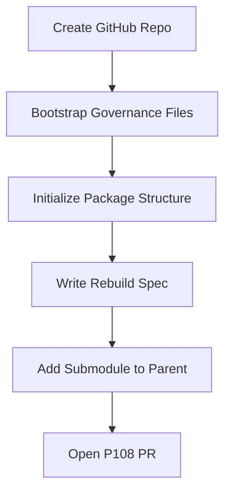
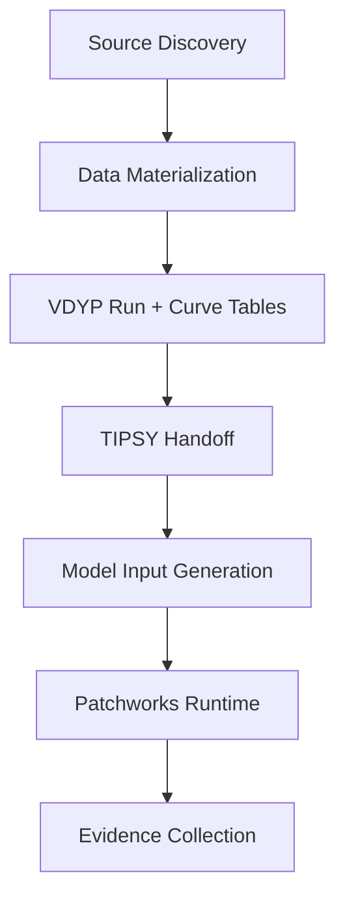

# FreshForge Workflow Definitions for TSA23 Instance

## Bootstrap Workflow Graph

This directory contains FreshForge-style workflow definitions for the TSA23 instance.
Each workflow is a DAG (directed acyclic graph) specifying stages, dependencies, and
validation gates.

### Bootstrap Workflow (P108)

The bootstrap workflow completed in P108:

### Materialization Workflow (P109+)

Future workflows for actual data materialization will follow this pattern:

### Validation Gates

Each workflow stage must pass validation gates before proceeding:

- **Source Discovery:** All required layers identified, paths resolved
- **Data Materialization:** VDYP runs complete, curve tables non-empty
- **TIPSY Handoff:** Human-review input files generated
- **Model Input Generation:** forestmodel.xml validated, fragments complete
- **Patchworks Runtime:** Matrix Builder succeeds, accounts.csv sanity checks pass
- **Evidence Collection:** Invariant checks all pass
